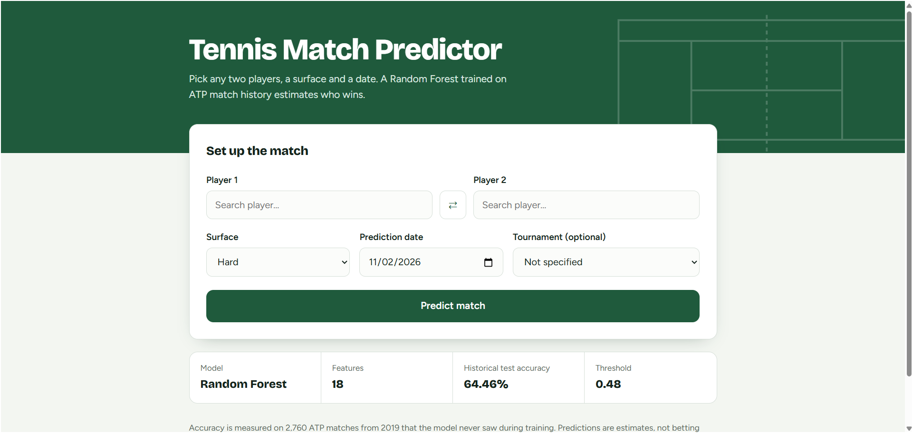
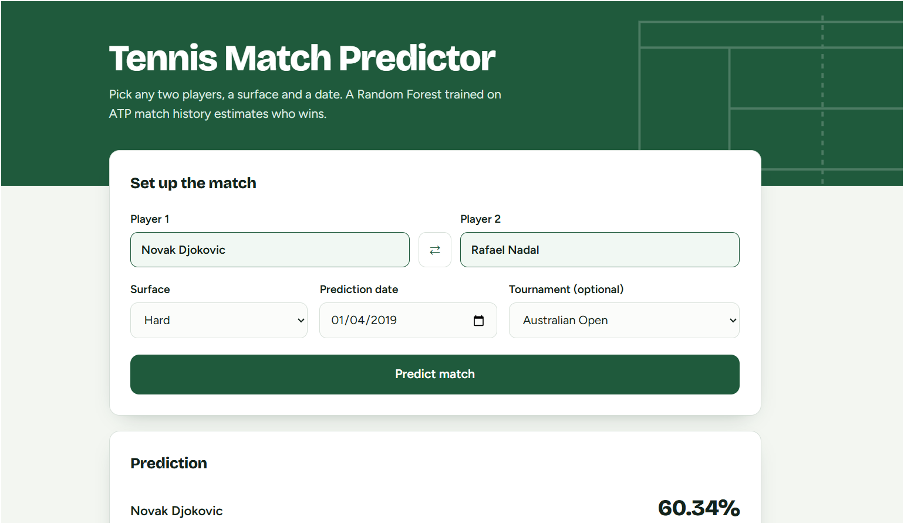
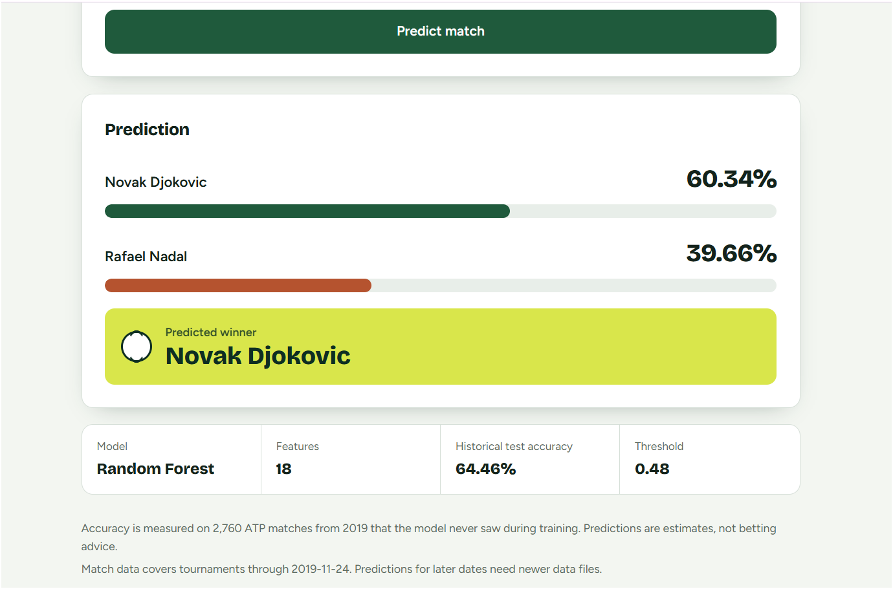
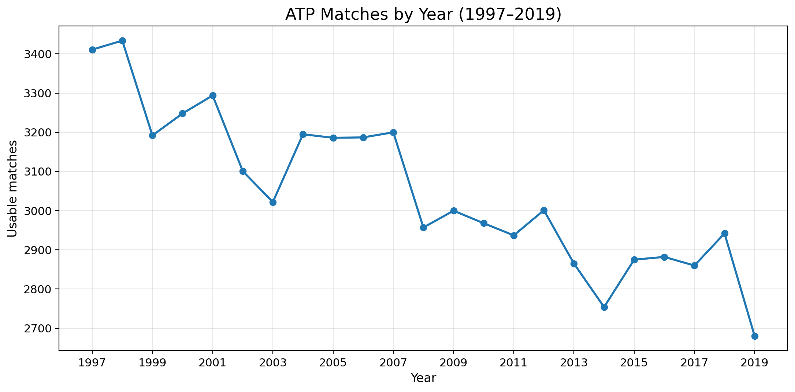
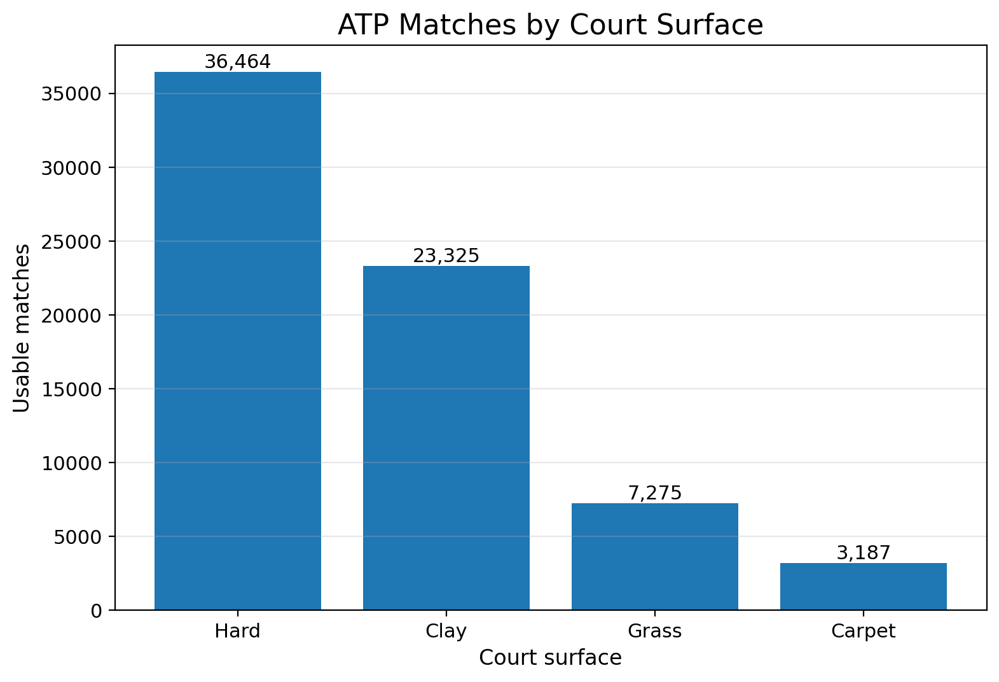
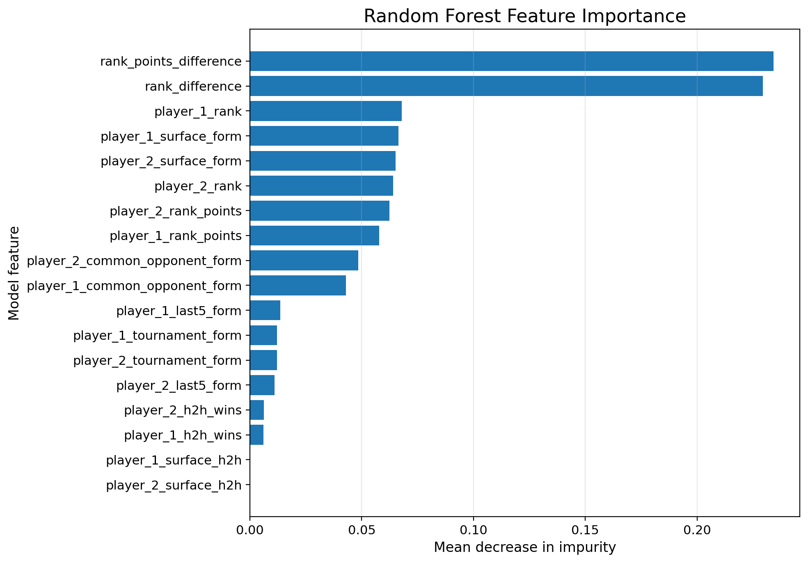

# Tennis Match Predictor

A web application that predicts the winner of a men's ATP tennis match between **any two players** using a Random Forest trained on historical match data.

## 1. Objective
Turn an existing machine-learning project into a working web app: the user searches two players, picks a surface and a date, and receives win probabilities and a predicted winner calculated by the saved model.

## 2. Problem statement
Given two players, a surface and a date, estimate the probability that each player wins, using **only information that was available before that date**.

## 3. Dataset
Jeff Sackmann's `tennis_atp` match files (`data/atp_matches_YYYY.csv`, CC BY-NC-SA 4.0, attribution required, non-commercial use). The supplied files cover **1997 to November 2019** (70,251 usable matches, 2,051 players). Men's ATP tour only: WTA players are not supported.

## 4. Data preprocessing
Matches missing a winner/loser name, either ranking, either ranking-points value, the surface or the tournament name are dropped. Matches are sorted by tournament date and match number. Every match becomes two training rows (winner as player 1 with target 1, loser as player 1 with target 0).

## 5. Feature engineering
Each feature is computed from matches played **before** the match being described (`src/create_surface_h2h_features.py` for training, `src/prediction_features.py` for the web app, same definitions).

## 6. The 18 features
| Feature (for each player unless noted) | Meaning |
|---|---|
| `rank`, `rank_points` (+ difference) | ranking and points |
| `last5_form` | win rate over the last 5 matches |
| `surface_form` | win rate on the chosen surface |
| `tournament_form` | win rate at the chosen tournament |
| `h2h_wins` | previous wins against this opponent |
| `common_opponent_form` | win rate against opponents both players have faced |
| `surface_h2h` | always 0.5 in the trained model (see Limitations) |

## 7. Random Forest
`RandomForestClassifier(n_estimators=200, max_depth=10, min_samples_leaf=2, random_state=42)`, trained on 1997-2018 (`src/save_final_model.py`), saved as `data/final_tennis_model.pkl`. The web app only **loads** it; it is never retrained.

## 8. Threshold selection
The decision threshold **0.48** (`data/final_threshold.txt`) was chosen on 2018 validation data (`src/tune_unbiased_threshold.py`), not on the test set. Player 1 is predicted to win if `P(player 1) >= 0.48`.

## 9. Unbiased evaluation
The 2019 matches were never used for training or threshold selection. One row per match is evaluated, with the alphabetically-first player as player 1 so the player order cannot bias the result.

## 10. Historical test accuracy
**1779 of 2760 correct = 64.46%.** Earlier 72%/81%/91% numbers came from biased experiments and are not used. This is accuracy on 2019 men's ATP matches, not a guarantee for other years.

## 11. Web architecture
```
User
  ↓
Frontend (HTML / CSS / JavaScript)
  ↓  GET /api/players/search , POST /api/predict
Flask API (app.py)
  ↓
Historical match data (data/atp_matches_*.csv, loaded once)
  ↓
Feature generation (src/prediction_features.py)
  ↓
Random Forest (data/final_tennis_model.pkl, loaded once)
  ↓
Prediction (probabilities + threshold 0.48)
  ↓
Frontend
```

## 12. API
| Endpoint | Purpose |
|---|---|
| `GET /` | the web page |
| `GET /api/players` | all supported players |
| `GET /api/players/search?q=djo` | partial-name search |
| `GET /api/tournaments` | tournaments from the latest year in the data |
| `GET /api/status` | model loaded? data coverage |
| `POST /api/predict` | make a prediction |

Request: `{"player1": "...", "player2": "...", "surface": "Hard", "date": "2019-12-01", "tournament": "Australian Open"}` (`date` defaults to today, `tournament` is optional).
Response: `player1`, `player2`, `player1_probability`, `player2_probability`, `predicted_winner`, `threshold`, `historical_test_accuracy`, `notes`, plus the 18 model inputs under `model_input`.
Errors return `{"error": "..."}` with status 400 (bad input), 404 (unknown player), 422 (insufficient data) or 503/500. Stack traces are never sent to the browser.
## Interactive GUI Demonstration 

### 1. Homepage


### 2. Player Selection


### 3. Prediction Result


## 13. Feature generation
`build_match_features(player1, player2, surface, prediction_date, tournament=None)` in `src/prediction_features.py`:
* uses only tournaments that were **finished before the date** (the data stores a tournament's start date only, so this is the conservative way to avoid leaking future matches);
* takes each player's ranking and points from their latest match before the date, and refuses if that is older than 365 days;
* requires at least 5 prior matches per player;
* returns the exact 18 features in training order;
* when a "form" feature has no history (never played on that surface, no common opponents, no tournament chosen), uses the trained convention 0.5 **and tells the user in `notes`**.

If requirements are not met the API answers: *"Insufficient historical data to generate a reliable prediction."* followed by the reason. Nothing is ever filled in silently.

## 14. Installation
Requires Python 3.10+.
* Windows: double-click `setup.bat` (creates `.venv` and installs `requirements.txt`).
* macOS/Linux: `./setup.sh`

`requirements.txt` pins `scikit-learn==1.9.1`, the version the model was saved with.

## 15. Configuration
No API keys are needed. Optional settings go in a `.env` file (copy `.env.example`): `HOST`, `PORT`, `FLASK_DEBUG`, `MIN_PRIOR_MATCHES`, `MAX_RANK_AGE_DAYS`. `.env` is git-ignored.

**To predict for current players** (for example Carlos Alcaraz), download `atp_matches_2020.csv` and every later year from Jeff Sackmann's `tennis_atp` repository into `data/`, then restart. The model itself is not retrained; the new files only supply recent form and rankings.

## 16. How to run
* Windows: double-click `run.bat`; macOS/Linux: `./run.sh`
* then open http://127.0.0.1:5000

Tests: `.venv\Scripts\python -m unittest tests.test_prediction_system -v` (Windows) or `.venv/bin/python -m unittest tests.test_prediction_system -v`.

## 17. Example prediction
Novak Djokovic vs Daniil Medvedev, Hard, Australian Open, date 2019-12-01 (output of the real model):
Novak Djokovic 72.96% · Daniil Medvedev 27.04% · predicted winner: Novak Djokovic.

## 18. Testing performed
24 automated tests: model loads with the 18 features in order; threshold is 0.48; the saved model still reproduces 1779/2760 on 2019; web-app features match the original training CSV exactly on 400 sampled matches (0 mismatches); tournament form checked independently; no future data used; probabilities sum to 1 and come from `predict_proba`; results are independent of player order; different surfaces and dates change the output; unknown player, same player, invalid surface/date/tournament, insufficient data, model-load failure, missing data folder and unexpected exceptions are all handled.

## 19. Limitations
* The supplied data ends **2019-11-24**. Without newer files, the app correctly refuses current-date predictions and cannot find players who debuted later (e.g. Carlos Alcaraz).
* Men's ATP only (no WTA).
* The model was trained on 1997-2018; accuracy on later years is unmeasured.
* Rankings come from each player's latest match, not weekly ranking tables.
* Tournament results are only counted once the whole tournament is finished, so the event in progress is ignored.
* `surface_h2h` carries no information: the training script gave both players identical counts, so it is always 0.5 (importance 0.0). It is reproduced as is, because fixing it would require retraining.
* Probabilities are estimates from a model that is right about 64% of the time.

## 20. Future improvements
Fix and retrain with a correct `surface_h2h`; train on 2020+ data; use weekly ranking files; add serve/return statistics and fatigue features; add WTA data; calibrate probabilities; deploy with a production WSGI server.

## 21. Project Visualizations

### 1. ATP Matches by Year

Shows the distribution of usable ATP matches from 1997 to 2019.



### 2. ATP Matches by Court Surface

Compares the number of matches played on Hard, Clay, Grass and Carpet courts.



### 3. Random Forest Feature Importance

Shows the relative importance of the features used by our trained Random Forest model.



